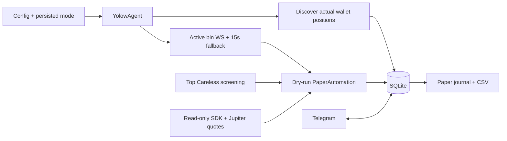

# Yolow Agent Architecture

Yolow runs as one Node.js process: validated configuration, Helius RPC/WebSocket, SQLite, background jobs and an authorized Telegram long poller.

| Module | Responsibility |
| --- | --- |
| `src/main.ts` | Validate credentials/config, refuse automation with persisted LIVE, load signer only for existing LIVE execution, graceful shutdown |
| `src/agent.ts` | Discovery, active-bin feed, automation, PnL reminders, snapshots, exports and backups |
| `src/automation/rules.ts` | Integer SOL amounts, orientation-aware SPOT range, bin-distance OOR/net profit priority, freshness and dust threshold |
| `src/automation/market.ts` | Read-only DLMM cost/bin/holding data, Jupiter quotes, shadow shares/fee model; no signing/broadcast |
| `src/automation/automation.ts` | Reservations, slot budget, virtual entry, manual/virtual simulated closes, ledger, pending swaps, loss blocks and recovery |
| `src/positions/monitor.ts` | Actual on-chain discovery and persisted ignore state |
| `src/positions/pnl.ts` | Cached Meteora lifetime SOL PnL and basis for actual positions |
| `src/market-data/active-bin.ts` | Shared per-pool WS feed, polling fallback and stale-feed suppression, including virtual pools |
| `src/market-data/top-careless.ts` | Shared screening/ranking; pre-limit mint/bin-step exclusions for automation |
| `src/market-data/candles.ts` | Historical data for journal marks only |
| `src/execution/executor.ts` | Existing validated close/swap execution and recovery; rejects retired trigger reasons |
| `src/storage/db.ts` | Existing positions, transactions, journal, snapshots and historical audit schema |
| `src/telegram/commands.ts` | Positions, automation status/unblock, settings, journal and guarded LIVE confirmation |
| `src/telegram/bot.ts` | Six-button home, persistent keyboard, eight native commands, grouped help and authorization |

Automation is single-flight. A reservation consumes a slot before asynchronous cost checks. Fresh discovery, wallet budget, duplicate checks and dry-run state are rechecked before atomically debiting principal/rent/gas and committing OPEN. All actual positions, including ignored/manual ones, consume slots; a manual simulated close cannot release a real slot.

The manual blacklist is a validated `top_careless.blacklisted_mints` array, defaulting to empty for older configs. Authorized `/blacklist` commands reuse atomic config writes, hot apply and config-change audit. Shared screening excludes matching token mints before metadata requests and result limits; automation also checks the current blacklist before reservations and OPEN commits. This blocks entry/reentry while preserving exits for existing positions. Loss blocks in SQLite remain independent.

Virtual positions persist bin shares, opening allocation, fee baselines and refundable rent. Current bin balances and fee accumulators estimate SOL/token holdings. Empty bins use ideal fills at bin prices. This model omits market impact and cannot reproduce an actual LP position exactly; it is restricted to dry-run. Manual profit requires fresh Meteora deposit/withdrawal/claimed-fee basis plus read-only SDK holdings and conservative liquidation quotes.

Exit priority is lower OOR loss at ≥20 bins, upper OOR at ≥10 bins, then net SOL take-profit at ≥5%. Bin distances use token/SOL price direction and invert for SOL on X. Executor rechecks reuse the shared exit rule. Legacy percentage CLOSING rows retain sweep/reentry semantics without rewriting history; new percentage triggers are rejected. OPEN → CLOSING atomically records holdings, credits close proceeds/rent minus gas and blocks a loss mint. CLOSING persists while the quote fails; recovery retries only the swap. Loss swaps include the whole wallet mint balance; journal profit allocates only the position share. Dust leaves token balances unchanged and credits no SOL. CLOSING → CLOSED atomically debits swapped tokens, credits net SOL and writes a unique `paper:<uuid>` journal row. No actual position is marked CLOSED by this flow.

Paper tables are `automation_positions`, `automation_balances`, `automation_blocks` and `automation_events`; preferred upper-OOR reentry is persisted in meta. Reservations without a committed debit are cleared after restart. OPEN/CLOSING positions, models, offsets and blocks are retained. Legacy signals/candles/triggers remain historical records; their engines, timers and editable config have been removed.

Existing live transaction protections remain: signer ownership, validated Jupiter instruction decoding, simulate-before-send, PENDING/UNKNOWN reconciliation, actual transaction metadata and no blind resend. They do not supply an automatic LIVE entry implementation. Automation activation and `/golive` are mutually exclusive.

Secrets stay in `.env` or an external permission-600 keypair; logs, Telegram and SQLite must not contain key material. Timestamps are UTC epoch milliseconds; presentation uses the configured time zone. Direct file edits require restart; supported Telegram changes hot apply unless flagged otherwise. Run one Yolow process and restart only `yolow` after tested changes.
